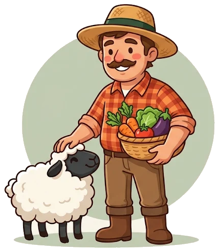

# El Vecino que Sabe

<p align="center">
  
</p>

> **Se ha leído el BOE para que tú no tengas que hacerlo.**

Asistente de inteligencia artificial que ayuda a agricultores y ganaderos de España a saber **a qué ayudas públicas pueden optar**, **qué requisitos cumplen y cuáles les faltan**, **cómo solicitarlas** y **qué alternativas tienen**. Siempre con la fuente oficial de cada dato.

Proyecto del **Tech for Inclusion Challenge**, en colaboración con **Ebury** y **Fundación Somos F5**.

**Demo desplegada:** _por añadir_

---

## Índice

- [La historia de Rafael](#la-historia-de-rafael)
- [El problema](#el-problema)
- [La solución](#la-solución)
- [Qué nos diferencia](#qué-nos-diferencia)
- [ODS a los que contribuye](#ods-a-los-que-contribuye)
- [Cómo funciona](#cómo-funciona)
- [Herramientas del agente](#herramientas-del-agente)
- [Ejemplos de interacción](#ejemplos-de-interacción)
- [Fiabilidad de los datos](#fiabilidad-de-los-datos)
- [Puesta en marcha](#puesta-en-marcha)
- [API](#api)
- [Tests](#tests)
- [Estructura del proyecto](#estructura-del-proyecto)
- [Seguridad y límites](#seguridad-y-límites)
- [Siguientes pasos](#siguientes-pasos)
- [Equipo](#equipo)

---

## La historia de Rafael

Rafael es ganadero en Teruel. Tenía **30 ovejas** y **el lobo le mató 5**. Ahora le quedan 25 y se hace tres preguntas: *¿sigo cobrando la ayuda de la PAC?, ¿me dan algo por el ataque?, ¿dónde lo miro?*

Hay un detalle que Rafael no sabe: la ayuda asociada al ovino de carne exige **un mínimo de 30 ovejas** (guía oficial de la PAC 2025 del Gobierno de Aragón). El ataque no solo le ha costado 5 animales: además puede dejarle sin la ayuda.

Rafael abre El Vecino que Sabe y escribe como habla:

> *«Tengo 25 ovejas en extensivo en Teruel y soy agricultor activo. ¿Qué ayudas puedo pedir?»*

En unos segundos, El Vecino le responde:

- ❌ **No cumple** la ayuda asociada al ovino: pide 30 ovejas y tiene 25.
- ⚠️ **Falta confirmar** el régimen de la explotación y el umbral de venta de corderos.
- ✅ **Cumple** la condición de agricultor activo.
- Le da el **enlace a la fuente oficial** y le avisa de que esa ayuda está *verificada automáticamente, no revisada por una persona*.

Sobre el lobo, El Vecino no se inventa nada: esa ayuda todavía no está en su base de datos, y así se lo dice.

## El problema

Las respuestas que necesita Rafael existen, pero están repartidas entre el BOE, el boletín de su comunidad, el FEGA, la Base de Datos Nacional de Subvenciones (BDNS) y la oficina comarcal. Además, están escritas en lenguaje administrativo y cambian cada campaña.

| Dato | Fuente |
|---|---|
| Más de **563.000** agricultores y ganaderos presentaron la solicitud única de la PAC en 2026 | Ministerio de Agricultura, Pesca y Alimentación (MAPA) |
| El **78 %** de quienes solicitan ayudas de la PAC usa algún tipo de ayuda externa para preparar la solicitud | Comisión Europea, encuesta de simplificación de la PAC (2024) |
| **1 de cada 3** agricultores europeos dedica unos **6 días al año** a los trámites de la PAC | Comisión Europea, encuesta de simplificación de la PAC (2024) |

El problema no es la falta de competencias digitales: es la **complejidad del trámite**. Por eso los agricultores pierden ayudas a las que tienen derecho o dependen de intermediarios.

## La solución

El agricultor escribe (o habla) con sus palabras, o rellena el formulario **«Mi explotación»**, y El Vecino que Sabe le responde a tres preguntas:

1. **¿A qué ayudas puedo optar?** Busca las ayudas que encajan con su explotación.
2. **¿Qué cumplo y qué me falta?** Revisa requisito por requisito: ✅ cumple · ⚠️ sin confirmar · ❌ no cumple.
3. **¿Cómo la pido?** Explica dónde, cuándo y con qué documentos y, si una ayuda no encaja, propone alternativas.

La interfaz incluye una portada explicativa, el chat con preguntas de ejemplo, el formulario «Mi explotación», un panel con las ayudas encontradas y sus fuentes, historial guardado solo en el dispositivo, dictado por voz con el reconocimiento del navegador y lectura de las respuestas en voz alta.

## Qué nos diferencia

| Un chatbot genérico | El Vecino que Sabe |
|---|---|
| Puede inventarse requisitos o importes | Solo habla de ayudas que devuelven sus herramientas |
| «Seguro que te la dan» | Informa de requisitos, nunca garantiza la concesión |
| Respuestas genéricas | Evalúa requisito por requisito con los datos del usuario |
| No se sabe de dónde saca la información | Cada ayuda lleva fuente oficial, fecha y nivel de fiabilidad |

La clave técnica: **la elegibilidad la calcula código determinista, no el modelo de lenguaje.** La IA explica el resultado, pero no puede convertir un «no cumple» en un «cumple».

## ODS a los que contribuye

| ODS | Qué cambia para Rafael |
|---|---|
| **8 · Trabajo decente y crecimiento económico** | Que no pierda dinero al que tiene derecho y su explotación siga viva y dando empleo |
| **10 · Reducción de las desigualdades** | Que la ayuda le llegue aunque viva lejos de la oficina y no tenga gestoría |
| **17 · Alianzas para lograr los objetivos** | Que le conecte con los fondos de la UE, del Estado y de su comunidad |

## Cómo funciona

```
Frontend (React + Vite, servido con nginx)
        │  REST
        ▼
Backend (FastAPI) ── POST /api/chat
        │
        ▼
Agente ── modo single (por defecto en la demo) o modo loop
        │
        ▼
Herramientas deterministas ── search_aids · check_eligibility · get_application_guide · find_alternatives
        │
        ▼
Base de ayudas (Postgres o, si no hay base de datos, ficheros JSON)
```

El agente tiene **dos modos**, que se eligen con la variable `AGENT_MODE`:

| Modo | Quién elige las herramientas | Llamadas al LLM | Cuándo usarlo |
|---|---|---|---|
| `single` (el de la demo) | El código, con reglas sobre la pregunta | 1, para explicar los resultados | Con el plan gratuito de Groq: responde en unos 3 segundos |
| `loop` | El LLM, con *function calling* | 3 o 4 por respuesta | Con un plan de IA con más capacidad: en el plan gratuito tarda 80–90 segundos |

**Por qué usamos `single` en la demo:** el plan gratuito de Groq da unos 8.000 tokens por minuto, y el bucle de *function calling* necesita varias llamadas por respuesta, así que se quedaba sin margen. El modo `loop` está implementado y probado (tiene sus propios tests), y volver a él es la primera de nuestras [mejoras](#siguientes-pasos).

En los dos modos:
1. Se extrae el perfil de la explotación de la pregunta y del formulario (comunidad, tipo de ganado, número de animales, edad…).
2. Las herramientas buscan y evalúan sobre la base de ayudas. Los requisitos son reglas del tipo *campo · operador · valor* (por ejemplo, `head_count >= 30`), y cada regla verificada lleva la **cita literal** de la fuente oficial.
3. El LLM redacta la respuesta en español claro. Un filtro final corrige términos internos antes de mostrarla.
4. La interfaz muestra la respuesta, las ayudas evaluadas, las fuentes y las herramientas utilizadas.

El system prompt está en [`backend/app/agent/system_prompt.md`](backend/app/agent/system_prompt.md), y el modo `single` en [`backend/app/agent/single.py`](backend/app/agent/single.py).

## Herramientas del agente

| Herramienta | Cuándo se usa | Qué devuelve |
|---|---|---|
| `search_aids` | El usuario pregunta qué ayudas hay o a cuáles puede optar | Ayudas candidatas según territorio, actividad y ganado |
| `check_eligibility` | Pregunta si cumple una ayuda, qué le falta o qué exige | El estado de cada requisito, el resultado global y una recomendación |
| `get_application_guide` | Pregunta cómo, dónde o cuándo solicitarla | Organismo, plazo, pasos y documentos (solo si la ayuda está verificada) |
| `find_alternatives` | No cumple una ayuda o no hay resultados útiles | Ayudas relacionadas y qué cambio le haría elegible |

Los esquemas de parámetros están en [`backend/app/agent/tool_schemas.py`](backend/app/agent/tool_schemas.py).

## Ejemplos de interacción

Pruebas reales hechas el 12/11/2026 con la base de ayudas actual.

### 1. Rafael después del ataque del lobo (modo `single`)

**Pregunta:** *«Tengo 25 ovejas en extensivo en Teruel y soy agricultor activo. ¿Qué ayudas puedo pedir?»*

**Razonamiento y herramientas:** el código extrae el perfil (Aragón, ovino, 25 animales, extensivo, agricultor activo) y ejecuta `search_aids`, que encuentra 3 ayudas. Después ejecuta `check_eligibility` sobre cada una de las tres. El LLM hace una única llamada para explicar el resultado. **Tiempo: 2,6 segundos.**

**Respuesta (resumida):**
- Ayuda asociada al ovino y caprino de carne: ❌ **no cumple**, porque necesita al menos 30 ovejas elegibles y tiene 25. El régimen extensivo o semiextensivo queda sin confirmar.
- Ayuda básica a la renta y ayuda redistributiva: ⚠️ **sin confirmar**, porque sus requisitos aún no están verificados contra la fuente oficial.

### 2. El mismo caso, con el agente decidiendo (modo `loop`)

**Pregunta:** *«Tengo 20 ovejas en extensivo en Teruel y soy agricultor activo. ¿Qué ayudas puedo pedir?»*

**Razonamiento y herramientas:** el LLM decide llamar a `search_aids` con el perfil que extrae de la pregunta y después a `check_eligibility` sobre la ayuda del ovino, pasando `head_count: 20`.

**Respuesta (resumida):** ❌ no cumple el mínimo de 30 ovejas; ✅ ovino y agricultor activo; ⚠️ falta confirmar el umbral de venta de 0,6 corderos por hembra. Cita la guía oficial de Aragón con la etiqueta *«Verificada automáticamente contra la fuente oficial el 12/11/2026 (no revisada por una persona)»*, y no recomienda solicitar una ayuda que no encaja.

### 3. Una pregunta general sin datos

**Pregunta:** *«¿Qué ayudas hay para una explotación agrícola?»*

**Razonamiento y herramientas:** sin ubicación, `search_aids` busca solo ayudas de ámbito nacional y devuelve las dos ayudas a la renta.

**Respuesta (resumida):** las dos ayudas salen como ⚠️ **sin confirmar**, y el agente explica que sus requisitos todavía no están registrados, **sin inventarse ninguno**. Después pide la comunidad, la superficie y los cultivos para afinar la búsqueda.

## Fiabilidad de los datos

| Nivel | Significado | Qué puede decir el agente |
|---|---|---|
| **Verificada por una persona** | Alguien distinto de quien la extrajo la comprobó contra el documento oficial | Cumple, no cumple o sin confirmar, requisito por requisito |
| **Verificada automáticamente** | Un agente comprobó las citas contra la fuente oficial; no la ha revisado una persona | Lo mismo, avisando de que la verificación es automática |
| **Sin verificar** | Datos extraídos o solo datos básicos de la ficha | Que la ayuda existe y el enlace oficial; nunca evalúa requisitos |

Reglas que el código hace cumplir:
- Un dato que falta **nunca** cuenta como cumplido: el requisito pasa a «sin confirmar».
- Una ayuda solo es «verificada» si lleva `verified_by` y cada regla evaluable tiene su cita oficial.
- El agente nunca garantiza la concesión: la decide la administración.

**Base actual:** 4 ayudas. Dos verificadas automáticamente: la ayuda asociada al ovino y caprino de carne (guía oficial de Aragón, PAC 2025) y la del vacuno de carne extensivo (ficha oficial de Aragón, PAC 2026, con el plazo ya cerrado). Otras dos sin verificar: la ayuda básica a la renta y la redistributiva.

## Puesta en marcha

**Requisitos:** Docker y Docker Compose, y una clave de [Groq](https://console.groq.com) (o de cualquier API compatible con OpenAI).

```bash
cp .env.example .env        # rellena LLM_API_KEY; deja AGENT_MODE=single
docker compose up --build
```

- Aplicación: http://localhost:3000
- API y documentación interactiva: http://localhost:8000/docs
- Estado del servicio: http://localhost:8000/api/health

Si cambias el `.env`, recrea el backend para que lo lea: `docker compose up -d --force-recreate backend`.

Para recargar las ayudas en la base de datos tras un cambio en `backend/data/*.json`:

```bash
docker compose run --rm backend python -m app.db.seed
```

### Frontend en modo desarrollo

```bash
docker compose up db backend
cd frontend
npm install
npm run dev          # http://localhost:5173 (reenvía /api al backend)
npm run dev:mock     # sin backend: respuestas de ejemplo, con un aviso en pantalla
```

Si el puerto 5173 está ocupado, Vite usa el siguiente (5174) y lo indica en la terminal.

### Problemas frecuentes

- **El puerto 5432 está ocupado** (por ejemplo, por un PostgreSQL instalado en Windows): añade `POSTGRES_HOST_PORT=5433` a tu `.env`.
- **Las respuestas tardan más de un minuto:** comprueba que el `.env` tiene `AGENT_MODE=single` y recrea el backend.
- **Comprobar la clave del LLM:** `docker compose run --rm --no-deps backend python scripts/probe_groq.py`

### Variables de entorno principales

| Variable | Descripción | Valor por defecto |
|---|---|---|
| `LLM_API_KEY` | Clave del proveedor del LLM. **Nunca se sube al repositorio** | — |
| `LLM_BASE_URL` | Endpoint compatible con OpenAI | `https://api.groq.com/openai/v1` |
| `LLM_MODEL` | Modelo con soporte de *function calling* | `openai/gpt-oss-120b` |
| `AGENT_MODE` | `single` (una llamada al LLM) o `loop` (el LLM elige las herramientas) | `loop` en el código; `single` en `.env.example` |
| `MAX_AGENT_ITERATIONS` | Máximo de rondas de herramientas en modo `loop` | `4` |
| `LLM_TEMPERATURE` | Temperatura (baja = respuestas más estables) | `0.2` |
| `POSTGRES_PASSWORD` | Contraseña de la base de datos local | `elvecino_dev` |
| `POSTGRES_HOST_PORT` | Puerto de Postgres en tu máquina | `5432` |
| `SEED_ON_START` | Carga las ayudas al arrancar si las tablas están vacías | `true` |
| `ALLOWED_ORIGINS` | Orígenes permitidos por CORS | `http://localhost:3000,http://localhost:5173` |

## API

| Método | Ruta | Descripción |
|---|---|---|
| `POST` | `/api/chat` | Recibe la conversación y el perfil; devuelve la respuesta, las ayudas evaluadas, las fuentes y la traza de herramientas |
| `GET` | `/api/aids/{id}` | Detalle de una ayuda |
| `GET` | `/api/health` | Estado del servicio, número de ayudas y origen de los datos |

```bash
curl -X POST http://localhost:8000/api/chat \
  -H "Content-Type: application/json" \
  -d '{"messages": [{"role": "user", "content": "Tengo 25 ovejas en extensivo en Teruel y soy agricultor activo. ¿Qué ayudas puedo pedir?"}]}'
```

La respuesta incluye `answer`, `aids` (con el resultado de cada ayuda), `sources` (enlace, fecha y fiabilidad), `trace` (las herramientas usadas) y `coverage_notes`.

Límites de entrada: hasta 4.000 caracteres por mensaje del usuario y 30 mensajes por conversación.

## Tests

```bash
docker compose run --rm backend pytest      # backend: 132 tests
cd frontend && npm test                     # frontend: 35 tests
```

Los tests del agente usan un cliente simulado y nunca llaman al LLM, así que la integración continua (GitHub Actions) no necesita secretos.

## Estructura del proyecto

```
├── backend/
│   ├── app/
│   │   ├── agent/       # agente (modos single y loop), system prompt y esquemas de herramientas
│   │   ├── tools/       # motor de requisitos y las 4 herramientas
│   │   ├── models/      # modelos Pydantic: perfil, ayuda, API
│   │   ├── data/        # carga y validación de las ayudas
│   │   ├── db/          # Postgres: esquema y carga inicial
│   │   ├── bdns/        # cliente e importador de la BDNS
│   │   ├── core/        # configuración desde variables de entorno
│   │   └── main.py      # rutas de FastAPI
│   ├── data/            # aids.json y blocks.json (base de ayudas)
│   └── tests/
├── frontend/
│   └── src/             # React: portada, chat, «Mi explotación», panel de ayudas, voz
├── docs/                # documentación y la ilustración de Rafael
├── docker-compose.yml
└── compose.production.yaml
```

## Seguridad y límites

- Las claves van en variables de entorno; `.env` está en `.gitignore`.
- Las entradas se validan en el backend (Pydantic) y en el frontend.
- La respuesta del agente se muestra solo como texto (sin `dangerouslySetInnerHTML`), así que no hay riesgo de XSS, y solo se enlazan URLs `http(s)`.
- No se piden DNI ni datos bancarios. La conversación y el perfil se guardan solo en el dispositivo del usuario.
- Las pantallas de cuenta, suscripción y pago son una **vista previa**: los campos están desactivados y no se cobra nada.
- El agente **informa de requisitos, no garantiza concesiones**. Confirma siempre condiciones y plazos en la fuente oficial o en la oficina comarcal antes de solicitar.
- **Cobertura actual limitada:** pocas ayudas verificadas y todavía ninguna por daños de fauna como el lobo.

## Siguientes pasos

- **Agente que decide solo:** volver al modo `loop` con un plan de IA con más capacidad.
- **Más ayudas verificadas** por personas, no solo de forma automática.
- **Todas las comunidades autónomas** a través de la BDNS.
- **Daños por fauna:** ayudas por ataques del lobo, como el de Rafael.
- **Avisos de plazos** antes de que cierre cada convocatoria.
- **«Qué papeles necesito»:** lista descargable de documentos de cada convocatoria (PAC anterior, REGA/REGEPA, certificados de Hacienda y Seguridad Social, presupuestos).
- **Accesibilidad completa:** revisión WCAG y WAI-ARIA para personas con visión reducida.
- **Evaluación del agente:** un *golden dataset* que compruebe en cada cambio que siempre cita el BOE o la BDNS y no se inventa nada.

## Equipo

| Persona | Rol |
|---|---|
| Helen | Product Owner · presentación y contenido |
| Vane | Backend · datos de ayudas |
| Javier | Backend · agente y despliegue |
| Anas | Frontend · interfaz y demo |

Con el apoyo de **Ebury** y **Fundación Somos F5**.