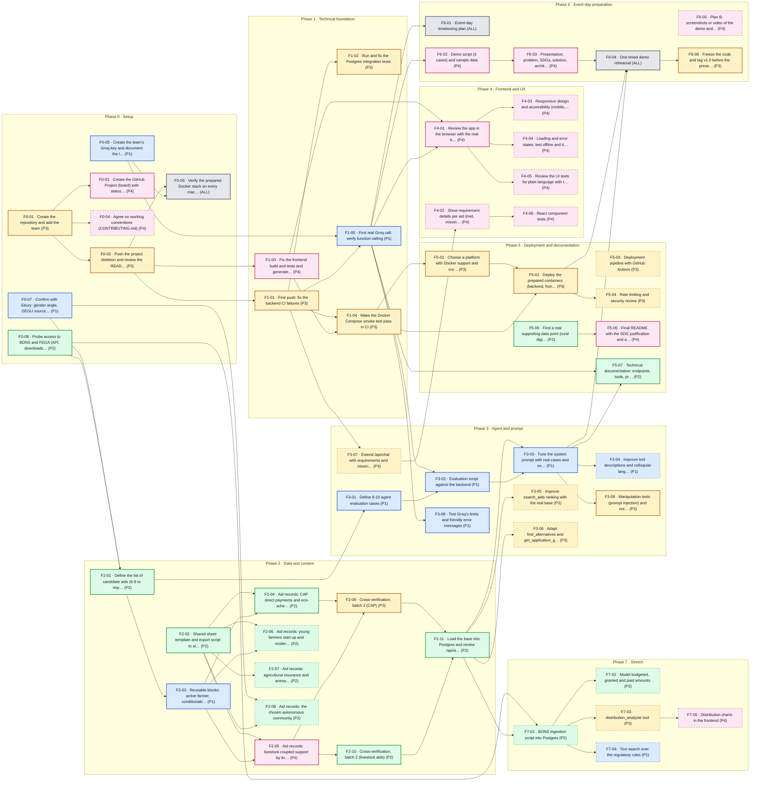

# Task dependencies

Generated from `tasks.csv` (57 tasks, 67 dependencies) by `plan/build_graph.py`. An arrow `A → B` means that **B cannot be finished until A is done**.

## Graph

**Legend:** colour is the owner (P1 blue, P2 green, P3 amber, P4 pink, everyone grey). Solid border = planned task (before the event or on the event day); **dashed border = stretch**.

## Critical path to v1.0 (23.5 h, non-stretch tasks only)

The longest chain of tasks that depend on each other up to F6-06 (code frozen and tagged). If one of them slips, the delivery slips. Hours use rough estimates (S = 1.5 h, M = 3.5 h, L = 7 h).

| # | Task | Owner | Est. | Description |
|---|---|---|---|---|
| 1 | F0-08 | P2 | M | Probe access to BDNS and FEGA (API, downloads and limits) |
| 2 | F2-01 | P2 | S | Define the list of candidate aids (6-8 to implement) |
| 3 | F2-03 | P1 | M | Reusable blocks: active farmer, conditionality and young farmer |
| 4 | F2-04 | P2 | M | Aid records: CAP direct payments and eco-schemes |
| 5 | F2-09 | P3 | M | Cross-verification, batch 1 (CAP) |
| 6 | F2-11 | P2 | S | Load the base into Postgres and review /api/aids |
| 7 | F3-03 | P1 | M | Tune the system prompt with real cases and examples with real aids |
| 8 | F6-04 | ALL | S | One timed demo rehearsal |
| 9 | F6-06 | P3 | S | Freeze the code and tag v1.0 before the presentations |

## Tasks that block the most others

| Task | Blocks | Description |
|---|---|---|
| F1-05 | 6 | First real Groq call: verify function calling |
| F0-02 | 3 | Push the project skeleton and review the README |
| F3-03 | 3 | Tune the system prompt with real cases and examples with real aids |
| F1-01 | 3 | First push: fix the backend CI failures |
| F0-05 | 2 | Create the team's Groq key and document the limits |
| F0-01 | 2 | Create the repository and add the team |

## Can start right away (no dependencies)

| Task | Owner | Description |
|---|---|---|
| F0-01 | P3 | Create the repository and add the team |
| F0-05 | P1 | Create the team's Groq key and document the limits |
| F0-07 | P1 | Confirm with Ebury: gender angle, DEGU source and priority region |
| F0-08 | P2 | Probe access to BDNS and FEGA (API, downloads and limits) |
| F2-02 | P2 | Shared sheet template and export script to aids.json |
| F5-06 | P2 | Find a real supporting data point (rural digital divide or reliance on paid agents) |
